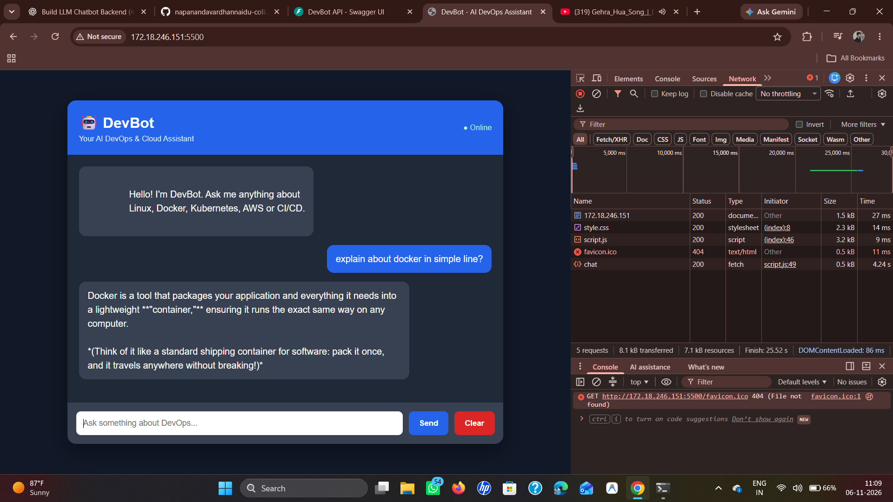

# DevBot – AI DevOps Assistant

DevBot is an AI-powered chatbot built using FastAPI, Google Gemini API, and HTML, CSS, and JavaScript.

It helps users understand DevOps, Cloud Computing, Linux, Docker, Kubernetes, and CI/CD through natural multi-turn conversations.

## Features

- Google Gemini API integration
- Multi-turn conversation support
- Conversation-specific memory
- Context window management (last 10 messages)
- Custom system prompt
- FastAPI REST API
- Simple web-based chat interface
- Clear conversation functionality
- Input validation and error handling
- API quota and timeout error handling

## Technology Stack

- Python 3.12
- FastAPI
- Google Gemini API
- Google GenAI Python SDK
- HTML
- CSS
- JavaScript
- Uvicorn

## Project Structure

```text
llm-api-chatbot/
├── app/
│   ├── __init__.py
│   ├── main.py
│   ├── memory.py
│   └── llm_client.py
├── frontend/
│   ├── index.html
│   ├── style.css
│   └── script.js
├── tests/
│   └── test_memory.py
├── .env
├── .gitignore
├── requirements.txt
└── README.md
```

## Installation

### 1. Clone the repository

```bash
git clone YOUR_GITHUB_REPOSITORY_URL
cd llm-api-chatbot
```

### 2. Create a virtual environment

```bash
python3 -m venv venv
source venv/bin/activate
```

### 3. Install dependencies

```bash
pip install -r requirements.txt
```

### 4. Configure the Gemini API key

Create a `.env` file in the project root:

```env
GEMINI_API_KEY=your_gemini_api_key
```

Never commit your API key to GitHub.

### 5. Start the backend

```bash
uvicorn app.main:app --reload
```

Backend URL:

http://127.0.0.1:8000

API documentation:

http://127.0.0.1:8000/docs

### 6. Start the frontend

Open another terminal:

```bash
python -m http.server 5500 --directory frontend
```

Open:

http://127.0.0.1:5500

## API Endpoints

| Method | Endpoint | Description |
|---|---|---|
| GET | / | API health check |
| POST | /chat | Send a message |
| GET | /history/{conversation_id} | Retrieve conversation history |
| DELETE | /history/{conversation_id} | Clear conversation history |

### Chat Request Example

```json
{
  "conversation_id": "user123",
  "message": "Explain Docker"
}
```

## Context Management

DevBot maintains separate conversation histories using conversation IDs.

It retains the latest 10 messages for each conversation and sends the available history with the next user request to Gemini.

Conversation history is stored in application memory and is cleared when the backend restarts.

## API Availability and Limitations

DevBot uses the Google Gemini API (`gemini-3.8-flash`) to generate AI responses.

### Temporary Service Unavailability (HTTP 503)

The Gemini API may occasionally return `503 Service Unavailable` when the model experiences high demand.

This is a temporary service-side availability issue and does not necessarily indicate a problem with the application code or API key.

#### Error Handling

DevBot handles Gemini API errors, including:

- **503 – Service Unavailable:** The Gemini model is temporarily experiencing high demand.
- **429 – Too Many Requests:** API quota or rate limit exceeded.
- **401/403 – Authentication Error:** API authentication or permission issue.
- **408/504 – Timeout:** The API request timed out.
- **502 – Bad Gateway:** Other Gemini API processing errors.

#### How to Resolve Temporary 503 Errors

If you encounter a 503 error:

1. Wait for some time.
2. Try sending your message again.
3. Check Gemini API quota and service availability if the problem continues.

#### Important Note

Free-tier API access does not guarantee uninterrupted availability. Temporary service interruptions, rate limits, and usage restrictions may apply.

These limitations are related to the external Gemini API service and do not necessarily indicate a defect in DevBot.

## Error Handling

- Invalid input validation
- Gemini API quota errors
- Authentication errors
- API request timeout errors
- Unexpected server errors

## Testing

Run the memory tests:

```bash
python -m unittest discover -s tests
```

## Limitations

- Requires an active Google Gemini API key.
- Gemini API usage depends on the account's quota and rate limits.
- Conversation history is stored in RAM and is not persistent across backend restarts.

## AI Usage Declaration

AI tools were used for development assistance, debugging, and documentation. The project was reviewed and tested by the developer.

## Application Screenshot

The following screenshot shows DevBot successfully responding to a Docker-related question using the Gemini API.



## Author

Nandu Vardhan

B.Tech – Computer Science and Engineering
